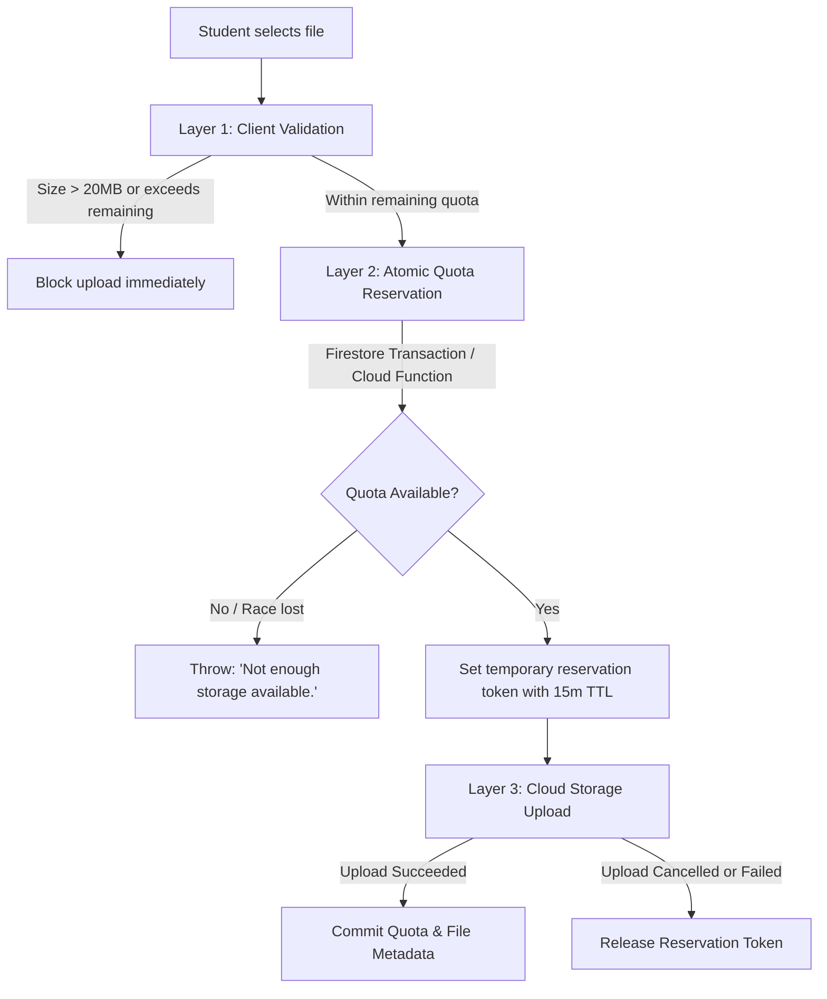

# SyncFile ☁️📁

> **"Your files. Anywhere. Anytime."**

SyncFile is a secure, student-friendly personal file storage web application built with **React**, **Vite**, **Tailwind CSS**, and **Firebase (Authentication, Cloud Storage, Cloud Firestore, and Cloud Functions)**. It allows students to effortlessly upload, organize, access, download, and delete study materials from any laptop, tablet, or phone with strict storage quotas and private access controls.

---

## Table of Contents
1. [Key Features](#key-features)
2. [Technology Stack](#technology-stack)
3. [Session Persistence & Tab Security](#session-persistence--tab-security)
4. [20 MB Storage Quota Architecture](#20-mb-storage-quota-architecture)
5. [Firebase Security Rules](#firebase-security-rules)
6. [Cloud Functions Backend](#cloud-functions-backend)
7. [Project Structure](#project-structure)
8. [Getting Started & Configuration](#getting-started--configuration)
9. [Running Tests & Verification](#running-tests--verification)
10. [Deployment](#deployment)

---

## Key Features

- **Google Authentication**: Instant, single-click sign-in without lengthy registration forms. Automatically provisions student profile and storage counters.
- **Tab-Session Persistence**: Configured with Firebase `browserSessionPersistence`. Closing a browser tab terminates access, protecting students on shared university library computers.
- **Strict 20 MB Account Quota**: Every account has an aggregate ceiling of exactly **20 MB (20,971,520 bytes)**. Real-time integer byte calculation prevents accidental or concurrent overages.
- **Drag-and-Drop File Uploads**: Support for PDFs, Word documents (`.doc`, `.docx`), PowerPoints (`.ppt`, `.pptx`), Spreadsheets (`.xls`, `.xlsx`, `.csv`), Text files, Images (`.jpg`, `.png`, `.webp`), and Archives (`.zip`).
- **Duplicate Name Protection**: Every uploaded file is assigned a unique UUID and isolated storage path (`users/{userId}/files/{fileId}/{fileName}`), preventing accidental overwrites.
- **Authenticated Downloads**: Files are downloaded directly through authenticated Firebase SDK streams (`getBlob`), preserving exact file bytes and original filenames without exposing permanent public URLs.
- **Safe Deletions**: Deleting files permanently removes the Cloud Storage object and Firestore record atomically while immediately releasing quota.
- **Real-Time Cloud Synchronization**: Firestore listeners (`onSnapshot`) keep desktop, laptop, and mobile devices in sync in real time.
- **Student-Friendly UI**: Calming cloud aesthetic with Indigo `#4F46E5` primary color, Inter typography, list and grid view switchers, responsive drawer navigation, and accessible toast notifications.

---

## Technology Stack

| Layer | Technology |
|---|---|
| **Frontend Framework** | React 19 + Vite 8 |
| **Styling** | Tailwind CSS v4 |
| **Icons** | Lucide React |
| **Authentication** | Firebase Authentication (Google OAuth Provider) |
| **File Storage** | Cloud Storage for Firebase |
| **Database** | Cloud Firestore |
| **Backend & Quotas** | Firebase Cloud Functions (Node.js) |
| **Testing** | Node.js Test Runner & Headless Chrome CDP Verification |

---

## Session Persistence & Tab Security

SyncFile strictly implements Firebase Authentication's **`browserSessionPersistence`** (`sessionStorage` semantics):

```javascript
import { setPersistence, browserSessionPersistence } from 'firebase/auth';

// Enforced before every authentication call
await setPersistence(auth, browserSessionPersistence);
```

### Intended Behavior:
1. **Active Tab Navigation & Refresh**: Reloading the current browser tab does **not** sign the student out.
2. **Closing the Tab / Session**: Closing the active tab or browser window ends the session.
3. **New Tab Behavior**: Opening SyncFile in a new tab requires authenticating again.
4. **No Local Storage Leaks**: No authentication tokens or user credentials are stored in permanent `localStorage`.

### Browser-Specific Limitations & Considerations:
- **Safari / iOS WebKit**: Tab suspension or aggressive background eviction in mobile Safari can occasionally cycle session memory if backgrounded for an extended period.
- **Chrome Tab Restore**: If Chrome crashes or if "Continue where you left off" is enabled with session restore, Chrome may restore the in-memory tab state of previously open tabs until explicitly closed.

---

## 20 MB Storage Quota Architecture

SyncFile treats storage quota as a strict, non-negotiable security invariant:

- **Limit**: Exactly `20 * 1024 * 1024` = **20,971,520 bytes**.
- **Internal Units**: Integer bytes are used internally for all transactions, prevent rounding errors. Display values are converted cleanly to `KB` and `MB` with two decimals.
- **Zero-Floor Protection**: Storage calculations are clamped using `Math.max(0, current - released)` to prevent negative storage under any race condition.

### Multi-Layer Quota Defense:


---

## Firebase Security Rules

### 1. Cloud Storage Security Rules (`storage.rules`)
```javascript
rules_version = '2';
service firebase.storage {
  match /b/{bucket}/o {
    function isAuthenticated() {
      return request.auth != null;
    }
    function isOwner(userId) {
      return isAuthenticated() && request.auth.uid == userId;
    }
    function isValidSize() {
      return request.resource.size > 0 && request.resource.size <= 20 * 1024 * 1024;
    }

    match /users/{userId}/files/{fileId}/{fileName} {
      allow read: if isOwner(userId);
      allow create: if isOwner(userId) && isValidSize() && resource == null;
      allow update: if false; // Disallow overwriting
      allow delete: if isOwner(userId);
    }

    match /{allPaths=**} {
      allow read, write: if false;
    }
  }
}
```

### 2. Cloud Firestore Security Rules (`firestore.rules`)
- Restricts profile reads and updates to the authenticated student owner.
- Disallows clients from arbitrarily updating quota counters (`totalStorageUsedBytes`, `storageLimitBytes`).
- Validates file metadata schema (`name`, `size`, `storagePath`, `ownerUid`).
- Denies all cross-user queries.

---

## Cloud Functions Backend (`functions/`)

Located in `functions/index.js`, the trusted backend contains:
1. `reserveUploadQuota`: Callable function executing a Firestore transaction that computes active pending reservations + current used storage + incoming size against 20 MB.
2. `onStorageObjectFinalized`: Cloud Storage event trigger updating `totalStorageUsedBytes` atomically and committing metadata.
3. `onStorageObjectDeleted`: Storage event trigger decrementing storage usage and removing metadata.

---

## Project Structure

```
SyncFile website/
├── public/
├── src/
│   ├── components/
│   │   ├── common/
│   │   │   ├── ConfirmDialog.jsx      # Reusable confirmation dialogs
│   │   │   ├── LegalModals.jsx        # Privacy Policy & Terms of Service
│   │   │   ├── Logo.jsx               # Cloud + File SVG branding
│   │   │   ├── Modal.jsx              # Accessible dialog wrapper
│   │   │   ├── Navbar.jsx             # Responsive header & student dropdown
│   │   │   ├── ProgressBar.jsx        # Colored progress bar with thresholds
│   │   │   └── Sidebar.jsx            # Desktop navigation sidebar
│   │   ├── dashboard/
│   │   │   ├── StorageStatsCards.jsx  # Overview cards (Files, Used, Free, %)
│   │   │   └── StorageView.jsx        # Storage category breakdown
│   │   ├── files/
│   │   │   ├── FileCard.jsx           # Grid view file card
│   │   │   ├── FileDetailsModal.jsx   # File inspection modal
│   │   │   ├── FileDropzone.jsx       # Drag & drop upload area
│   │   │   ├── FileList.jsx           # Table/grid file manager with search & sort
│   │   │   ├── FileListItem.jsx       # List/table row item
│   │   │   └── FileUploadModal.jsx    # Batch upload modal with progress
│   │   ├── profile/
│   │   │   └── ProfileModal.jsx       # Student profile & quota card
│   │   └── settings/
│   │       └── SettingsModal.jsx      # Security, session, and audit settings
│   ├── context/
│   │   ├── AuthContext.jsx            # Google OAuth & session management
│   │   ├── FileContext.jsx            # Real-time files state & actions
│   │   └── ToastContext.jsx           # Accessible toast notifications
│   ├── firebase/
│   │   └── config.js                  # Firebase initialization & browserSessionPersistence
│   ├── services/
│   │   ├── fileService.js             # Uploads, getBlob download, deletion
│   │   └── quotaService.js            # Atomic quota reservation & reconciliation
│   ├── utils/
│   │   ├── fileTypeIcons.jsx          # Category badges & Lucide icons
│   │   ├── formatters.js              # Integer byte calculations & date formatting
│   │   └── securityValidators.js      # Upload checks & friendly error mappings
│   ├── App.jsx                        # Main application controller
│   ├── index.css                      # Tailwind v4 configuration
│   └── main.jsx                       # React DOM entry point
├── functions/                         # Firebase Cloud Functions (Trusted Backend)
│   ├── index.js
│   └── package.json
├── scripts/
│   ├── test-suite.cjs                 # Automated unit & quota test suite
│   ├── verify-ui.cjs                  # Chrome CDP visual test harness
│   └── capture-modals.cjs             # Modals screenshot capture
├── firestore.rules                    # Production Firestore Security Rules
├── storage.rules                      # Production Storage Security Rules
├── firebase.json                      # Firebase Hosting & emulator config
├── .firebaserc                        # Firebase project aliases
├── .env.example                       # Environment variable template
└── README.md
```

---

## Getting Started & Configuration

### 1. Install Dependencies
```bash
npm install
```

### 2. Configure Firebase Environment Variables
Create a `.env` file in the root directory (based on `.env.example`):
```env
VITE_FIREBASE_API_KEY=AIzaSy...
VITE_FIREBASE_AUTH_DOMAIN=your-project-id.firebaseapp.com
VITE_FIREBASE_PROJECT_ID=your-project-id
VITE_FIREBASE_STORAGE_BUCKET=your-project-id.appspot.com
VITE_FIREBASE_MESSAGING_SENDER_ID=123456789012
VITE_FIREBASE_APP_ID=1:123456789012:web:abcdef...
```

> **Note on Sandbox Mode**: If Firebase credentials are not yet entered, SyncFile automatically runs in **Student Sandbox Mode** (`Alex Morgan (Student)`), allowing full interactive testing of the UI, drag-and-drop uploads, quota limits, deletions, and search/sort.

### 3. Firebase Console Setup Steps:
1. Go to [Firebase Console](https://console.firebase.google.com/) and create a project.
2. In **Authentication > Sign-in method**, enable the **Google** provider.
3. In **Firestore Database**, create a database in production mode.
4. In **Storage**, enable Cloud Storage for Firebase.
5. Deploy security rules:
   ```bash
   firebase deploy --only firestore:rules,storage
   ```
6. (Optional for backend triggers) Deploy Cloud Functions:
   ```bash
   cd functions && npm install && cd ..
   firebase deploy --only functions
   ```

### 4. Run Development Server
```bash
npm run dev
```

---

## Running Tests & Verification

### Unit & Security Test Suite:
Run the comprehensive test suite verifying 20 MB byte precision, directory traversal prevention, error mapping, and deletion non-negativity:
```bash
npm test
```

### Visual Verification:
Run the automated headless Chrome CDP visual capture:
```bash
node scripts/verify-ui.cjs
```

---

## Deployment

Build the production bundle:
```bash
npm run build
```

Deploy directly to **Firebase Hosting**:
```bash
firebase deploy --only hosting
```
Or deploy the entire suite (Hosting, Firestore Rules, Storage Rules, and Functions):
```bash
firebase deploy
```
